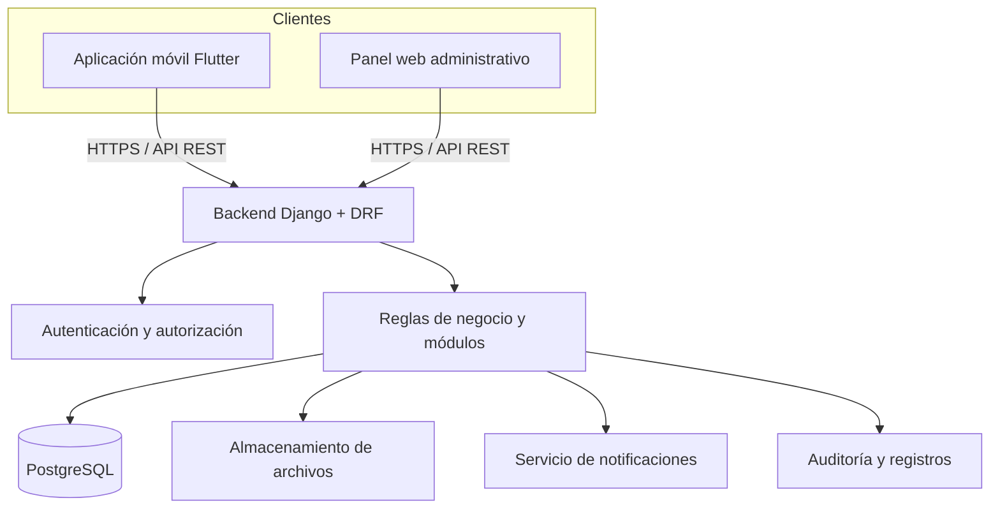
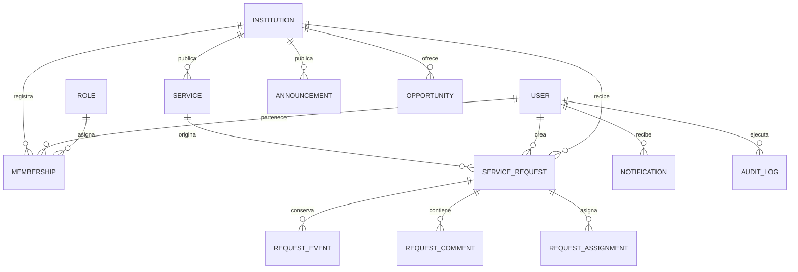

# NEXUS CAMPUS

### Ecosistema Inteligente de Servicios, Apoyo y Gestión Universitaria

> **Conectando oportunidades, personas y universidades.**

[](#estado-del-proyecto)
[](#plataformas)
[](#arquitectura-general)

NEXUS CAMPUS es una propuesta de plataforma digital para instituciones de educación superior. Su objetivo es reunir en un mismo ecosistema los servicios, recursos, oportunidades, solicitudes y herramientas de acompañamiento que necesita la comunidad universitaria.

El producto contempla una **aplicación móvil para estudiantes, docentes y personal institucional**, además de un **panel web de administración**. La solución se diseñará desde el inicio para que distintas universidades puedan utilizarla con espacios institucionales independientes, sin mezclar sus usuarios, configuraciones ni información.

> **Importante:** este repositorio documenta la visión, el alcance y el diseño inicial del producto. Las funciones, módulos, pantallas, endpoints y estructuras de datos descritos como propuestos todavía deben implementarse, probarse y validarse. La mención de una posible institución piloto no significa que exista una aprobación o integración institucional.

---

## Tabla de contenido

1. [Visión del proyecto](#1-visión-del-proyecto)
2. [Problema y oportunidad](#2-problema-y-oportunidad)
3. [Objetivos](#3-objetivos)
4. [Alcance y principios](#4-alcance-y-principios)
5. [Plataformas](#5-plataformas)
6. [Tipos de usuario y permisos](#6-tipos-de-usuario-y-permisos)
7. [Módulos funcionales](#7-módulos-funcionales)
8. [Flujos principales](#8-flujos-principales)
9. [Requisitos funcionales](#9-requisitos-funcionales)
10. [Requisitos no funcionales](#10-requisitos-no-funcionales)
11. [Arquitectura general](#11-arquitectura-general)
12. [Tecnologías propuestas](#12-tecnologías-propuestas)
13. [Estructura del repositorio](#13-estructura-del-repositorio)
14. [Modelo conceptual de datos](#14-modelo-conceptual-de-datos)
15. [Diseño inicial de API REST](#15-diseño-inicial-de-api-rest)
16. [Seguridad, privacidad y cumplimiento](#16-seguridad-privacidad-y-cumplimiento)
17. [Diseño de experiencia e interfaz](#17-diseño-de-experiencia-e-interfaz)
18. [Pruebas y criterios de calidad](#18-pruebas-y-criterios-de-calidad)
19. [Plan de desarrollo](#19-plan-de-desarrollo)
20. [Instalación y ejecución futura](#20-instalación-y-ejecución-futura)
21. [Configuración y variables de entorno](#21-configuración-y-variables-de-entorno)
22. [Estado y prioridades](#22-estado-y-prioridades)
23. [Riesgos y decisiones pendientes](#23-riesgos-y-decisiones-pendientes)
24. [Guía de contribución](#24-guía-de-contribución)
25. [Licencia y uso](#25-licencia-y-uso)
26. [Historial de versiones](#26-historial-de-versiones)

---

## 1. Visión del proyecto

Crear un ecosistema digital que conecte a la comunidad universitaria con los servicios y oportunidades de su institución, facilite la atención de solicitudes y proporcione información organizada para mejorar la gestión institucional.

NEXUS CAMPUS no pretende sustituir todos los sistemas académicos existentes. Busca funcionar como una capa de acceso y coordinación que conecte servicios, personas y procesos que actualmente pueden estar distribuidos en distintos canales.

### Propuesta de valor

- **Para estudiantes:** una entrada clara a servicios, oportunidades, recursos y canales de apoyo.
- **Para docentes:** acceso a herramientas y actividades autorizadas para su función.
- **Para áreas administrativas:** recepción, asignación y seguimiento ordenado de solicitudes.
- **Para instituciones:** información agregada para comprender la demanda y mejorar sus servicios.
- **Para el ecosistema:** una base tecnológica modular que pueda configurarse para distintas universidades.

## 2. Problema y oportunidad

En algunas instituciones, la información universitaria puede encontrarse repartida entre páginas, grupos de mensajería, documentos, oficinas y sistemas distintos. Esto puede provocar que una persona no sepa dónde consultar un servicio, qué requisitos necesita, a quién debe dirigirse o cómo revisar el avance de una solicitud.

Del lado institucional, las áreas pueden recibir solicitudes por varios medios, tener dificultades para darles seguimiento y carecer de indicadores unificados sobre tiempos de atención o necesidades recurrentes.

NEXUS CAMPUS propone centralizar el acceso y el seguimiento, siempre que la institución valide los procesos, responsables, información y permisos que se integrarán.

## 3. Objetivos

### Objetivo general

Diseñar y desarrollar una plataforma digital multiinstitucional que centralice el acceso a servicios, recursos, oportunidades y mecanismos de acompañamiento universitario, facilitando la comunicación entre la comunidad educativa y las áreas responsables.

### Objetivos específicos

1. Crear una experiencia móvil accesible para estudiantes, docentes y personal autorizado.
2. Proporcionar un catálogo organizado de servicios y recursos institucionales.
3. Permitir crear, asignar, consultar y cerrar solicitudes con trazabilidad.
4. Facilitar el acceso a tutorías, becas, convocatorias y servicios de bienestar disponibles.
5. Proporcionar herramientas de administración y reportes para las instituciones.
6. Aplicar separación de datos por institución, controles de acceso y prácticas de seguridad desde el diseño.
7. Construir una arquitectura modular que permita ampliar el producto por etapas.

## 4. Alcance y principios

### Incluido en la visión del producto

- Aplicación móvil multiplataforma.
- Panel web administrativo.
- Backend central y API REST.
- Gestión de cuentas, instituciones, roles y permisos.
- Catálogo de servicios, recursos y oportunidades.
- Solicitudes con estados, asignación, comentarios e historial.
- Módulos de acompañamiento académico y bienestar, de acuerdo con los servicios reales de cada institución.
- Notificaciones y avisos.
- Analítica institucional agregada.
- Herramientas inteligentes de apoyo, sujetas a revisión humana.
- Configuración independiente por institución.

### Fuera del alcance inicial

- Reemplazar el sistema oficial de control escolar, ERP, LMS o sistema financiero de una universidad.
- Tomar decisiones autónomas sobre becas, sanciones, diagnósticos o continuidad académica.
- Diagnosticar condiciones de salud física o mental.
- Garantizar la asignación de becas, préstamos, citas o servicios que dependen de disponibilidad institucional.
- Integrarse a sistemas privados sin autorización, documentación y acuerdos correspondientes.
- Compartir información de una institución con otra.

### Principios del producto

- **Utilidad real:** cada función debe resolver una necesidad validada.
- **Privacidad por diseño:** recopilar únicamente los datos necesarios.
- **Accesibilidad:** interfaces comprensibles y utilizables desde distintos dispositivos.
- **Transparencia:** explicar qué hace cada función inteligente y quién toma las decisiones.
- **Modularidad:** activar y configurar módulos según la institución.
- **Trazabilidad:** conservar registros de las operaciones administrativas relevantes.
- **Supervisión humana:** las decisiones institucionales importantes corresponden a personas autorizadas.

## 5. Plataformas

### Aplicación móvil

Se proyecta para Android y iOS mediante Flutter. Será el punto principal de acceso de estudiantes, docentes y personal que utilice funciones móviles.

### Panel web administrativo

Permitirá a usuarios institucionales autorizados administrar catálogos, solicitudes, usuarios, anuncios, configuraciones y reportes según sus permisos. La tecnología visual final del panel sigue pendiente de evaluación; la propuesta inicial contempla HTML, CSS y JavaScript, con posibilidad de evolucionar posteriormente.

### Backend y API

El backend concentrará las reglas de negocio, autenticación, autorización, validación de datos y comunicación con la base de datos. Ninguna aplicación cliente tendrá acceso directo a PostgreSQL.

## 6. Tipos de usuario y permisos

Los permisos definitivos deberán revisarse con cada institución. La siguiente matriz es una propuesta inicial de mínimo privilegio.

| Rol | Acceso propuesto |
|---|---|
| Estudiante | Consultar servicios, recursos y oportunidades; crear solicitudes propias; consultar su historial; solicitar tutorías o atención cuando estén disponibles. |
| Docente | Consultar recursos autorizados; publicar avisos si tiene permiso; gestionar tutorías o actividades que le sean asignadas. No tendrá acceso general a expedientes privados. |
| Personal administrativo | Atender solicitudes de su área, asignarlas, actualizar estados, administrar contenidos autorizados y consultar indicadores permitidos. |
| Administrador institucional | Gestionar usuarios, roles, catálogos, módulos, configuraciones e informes de su institución. |
| Administrador global NEXUS | Administrar el registro técnico de instituciones y la configuración global. El acceso excepcional a datos institucionales deberá limitarse, justificarse y quedar auditado. |

### Reglas de autorización

- Cada cuenta tendrá una relación explícita con una o más instituciones, cuando el caso lo permita.
- Los permisos se evaluarán en el backend en cada operación protegida.
- Un usuario solo podrá consultar los registros que correspondan a su institución y autorización.
- Los cambios de rol y permisos deberán quedar registrados.
- No se concederán privilegios administrativos por el simple hecho de pertenecer a una institución.

## 7. Módulos funcionales

### 7.1 NEXUS ACADEMIC — Acompañamiento académico

**Propósito:** facilitar el acceso a recursos y mecanismos de apoyo académico.

Funciones previstas:
- Panel de seguimiento académico cuando exista integración autorizada con los sistemas institucionales.
- Recordatorios de actividades y fechas importantes.
- Directorio de tutores y solicitud de tutorías.
- Vinculación de tutorías entre pares con reglas institucionales y participación voluntaria.
- Acceso a guías, recursos y canales de orientación académica.
- Indicadores agregados de demanda de tutorías y recursos.

**Límites:** no se etiquetará automáticamente a una persona como propensa a abandonar sus estudios ni se utilizarán indicadores como sanción. Los datos académicos solo se mostrarán con autorización y fundamento institucional.

### 7.2 NEXUS SUPPORT — Becas, oportunidades y recursos

**Propósito:** reunir oportunidades y recursos de apoyo disponibles.

Funciones previstas:
- Catálogo de becas, convocatorias y apoyos.
- Fechas, requisitos, documentos y enlaces oficiales.
- Directorio de comedor, transporte, descuentos u otros servicios cuando la institución proporcione información verificada.
- Consulta y solicitud de préstamo de laptops, equipo o materiales.
- Intercambio o préstamo de libros y materiales sujeto a reglas de moderación.
- Estado de solicitudes de préstamo y disponibilidad, cuando exista inventario institucional.

**Límites:** NEXUS CAMPUS informará y facilitará solicitudes, pero no garantizará la aprobación de apoyos ni sustituirá los procedimientos oficiales.

### 7.3 NEXUS WELLNESS — Bienestar universitario

**Propósito:** hacer más visible el acceso a los servicios de bienestar y orientación disponibles.

Funciones previstas:
- Directorio de servicios profesionales e institucionales.
- Solicitudes o reservación de citas, solo cuando exista disponibilidad integrada o confirmada.
- Horarios, ubicación, canales de contacto y talleres.
- Recordatorios de citas y actividades.
- Encuestas voluntarias de satisfacción.
- Estadísticas agregadas sobre uso de servicios.

**Límites:** el módulo no emitirá diagnósticos, no sustituirá a profesionales y no expondrá detalles sensibles en notificaciones. La atención dependerá de los equipos institucionales correspondientes.

### 7.4 NEXUS SERVICES — Solicitudes y servicios institucionales

**Propósito:** centralizar la atención y seguimiento de solicitudes.

Funciones previstas:
- Catálogo de trámites y servicios.
- Formulario de creación de solicitudes.
- Folio o identificador de seguimiento.
- Asignación a área o responsable.
- Estados configurables, por ejemplo: recibida, en revisión, en proceso, requiere información, resuelta y cerrada.
- Comentarios y comunicación relacionada con la solicitud.
- Historial de cambios y fechas.
- Adjuntos sujetos a límites y validaciones.
- Notificaciones de cambios relevantes.
- Panel de trabajo para las áreas responsables.

### 7.5 NEXUS INTELLIGENCE — Herramientas inteligentes

**Propósito:** reducir la fricción al encontrar información y clasificar solicitudes.

Funciones previstas:
- Búsqueda asistida de servicios, recursos y convocatorias.
- Sugerencias relacionadas con la consulta del usuario.
- Clasificación preliminar de solicitudes para facilitar su canalización.
- Ayuda para redactar o resumir información administrativa no sensible cuando esté autorizado.
- Explicación de por qué se muestra una sugerencia y posibilidad de revisión humana.

**Límites:** las sugerencias no serán decisiones definitivas. No se utilizarán para aprobar o rechazar becas, imponer sanciones, emitir diagnósticos o decidir la continuidad académica. La incorporación de proveedores de IA dependerá de un análisis de privacidad, costos, seguridad y condiciones de uso.

### 7.6 NEXUS ANALYTICS — Analítica institucional

**Propósito:** ofrecer una visión de operación y demanda de los servicios.

Indicadores previstos:
- Solicitudes recibidas, pendientes, atendidas y resueltas.
- Tiempos de atención por categoría o área.
- Uso de recursos, tutorías y convocatorias.
- Resultados de encuestas voluntarias de satisfacción.
- Tendencias por periodos y reportes descargables.

**Límites:** priorizar datos agregados; evitar mostrar grupos tan pequeños que permitan identificar a una persona. No presentar correlaciones como causas ni utilizar los reportes como evaluación automática de individuos.

## 8. Flujos principales

### Flujo A — Acceso del estudiante

1. El usuario abre la aplicación.
2. Se identifica mediante el mecanismo habilitado por la institución.
3. El backend valida la cuenta, la institución y los permisos.
4. La aplicación muestra el inicio y los módulos habilitados para ese usuario.
5. El usuario consulta un servicio, recurso u oportunidad.

### Flujo B — Creación y atención de una solicitud

1. El usuario selecciona un servicio del catálogo.
2. Consulta requisitos, tiempos y datos necesarios.
3. Envía la solicitud.
4. El backend valida la información y registra el folio.
5. El área correspondiente recibe la solicitud y la asigna.
6. El usuario consulta el estado y recibe avisos de cambios.
7. El responsable marca la solicitud como resuelta y registra el cierre.
8. El usuario puede responder una encuesta opcional.

### Flujo C — Publicación de una oportunidad

1. Un usuario institucional autorizado registra una beca o convocatoria.
2. Se capturan requisitos, vigencia, documentos y enlace oficial.
3. Se revisa y publica el contenido.
4. Los usuarios consultan la oportunidad y sus fechas.
5. El contenido se marca como vencido o se retira según su vigencia.

### Flujo D — Consulta administrativa

1. El administrador institucional ingresa al panel web.
2. El backend valida su rol y el alcance de su institución.
3. El panel muestra indicadores permitidos.
4. El administrador filtra por periodo, área o categoría.
5. Puede exportar reportes agregados según sus permisos.

## 9. Requisitos funcionales

Los identificadores son preliminares y deberán convertirse en historias de usuario y criterios de aceptación detallados.

| ID | Requisito | Prioridad inicial |
|---|---|---|
| RF-01 | Registrar o provisionar usuarios vinculados a una institución. | MVP |
| RF-02 | Iniciar y cerrar sesión de forma segura. | MVP |
| RF-03 | Administrar roles y permisos por institución. | MVP |
| RF-04 | Mostrar una pantalla de inicio según el rol y los módulos habilitados. | MVP |
| RF-05 | Consultar el catálogo de servicios institucionales. | MVP |
| RF-06 | Crear solicitudes y generar un folio de seguimiento. | MVP |
| RF-07 | Asignar solicitudes a áreas o responsables autorizados. | MVP |
| RF-08 | Actualizar estados y conservar un historial de cambios. | MVP |
| RF-09 | Consultar el historial propio de solicitudes. | MVP |
| RF-10 | Administrar anuncios y avisos institucionales. | MVP |
| RF-11 | Enviar notificaciones de eventos relevantes. | Alta |
| RF-12 | Publicar y consultar becas y convocatorias. | Siguiente etapa |
| RF-13 | Administrar recursos y solicitudes de préstamo. | Siguiente etapa |
| RF-14 | Solicitar tutorías y consultar recursos académicos. | Siguiente etapa |
| RF-15 | Consultar servicios de bienestar y solicitar citas cuando proceda. | Siguiente etapa |
| RF-16 | Consultar indicadores y generar reportes agregados. | Siguiente etapa |
| RF-17 | Ofrecer búsqueda y clasificación asistida con revisión humana. | Posterior |
| RF-18 | Configurar módulos y catálogos por institución. | MVP / evolución |
| RF-19 | Registrar operaciones administrativas relevantes en auditoría. | MVP |
| RF-20 | Mantener separación de datos entre instituciones. | MVP |

## 10. Requisitos no funcionales

- **Seguridad:** autenticación, autorización por rol e institución, validación de entradas, protección de secretos y comunicaciones cifradas.
- **Privacidad:** minimización de datos, finalidades claras, controles de acceso, retención definida y procedimientos de atención de derechos aplicables.
- **Disponibilidad:** definir objetivos de disponibilidad y recuperación según los recursos y acuerdos del servicio.
- **Rendimiento:** establecer y medir tiempos de respuesta con pruebas sobre escenarios representativos.
- **Escalabilidad:** permitir aumentar usuarios, instituciones y módulos sin rediseñar todo el producto.
- **Mantenibilidad:** separar responsabilidades por aplicaciones y mantener documentación técnica.
- **Accesibilidad:** contraste suficiente, textos legibles, navegación consistente, etiquetas y compatibilidad con tecnologías de asistencia donde sea posible.
- **Compatibilidad:** probar en versiones de Android/iOS y navegadores que se definan como soportados.
- **Trazabilidad:** registrar cambios importantes, actor, fecha y entidad afectada sin guardar secretos en logs.
- **Recuperación:** realizar respaldos y probar periódicamente su restauración.

Los valores medibles (por ejemplo, disponibilidad, tiempos máximos o versiones mínimas de sistema operativo) se fijarán después de definir el entorno de despliegue y realizar pruebas.

## 11. Arquitectura general

Se propone una arquitectura cliente-servidor con backend central y API REST.



### Responsabilidades

- **Aplicación móvil:** presentación de pantallas, navegación y captura de datos; no contiene credenciales de base de datos ni decide permisos finales.
- **Panel web:** administración de las funciones autorizadas; no se conecta directamente con PostgreSQL.
- **Backend:** valida identidad, institución, rol, permisos, reglas de negocio y datos; genera respuestas para los clientes.
- **PostgreSQL:** persiste la información estructurada.
- **Almacenamiento de archivos:** conserva documentos adjuntos con permisos y límites definidos.
- **Notificaciones:** comunica eventos sin incluir detalles sensibles en el contenido visible de la pantalla bloqueada.

### Enfoque multiinstitucional (multi-tenant)

La propuesta inicial utiliza una base PostgreSQL compartida y registros asociados a un `institution_id`. El backend debe aplicar el filtro institucional en cada consulta, modificación, búsqueda, exportación, tarea programada y notificación que involucre información de una institución.

No basta con ocultar información en la interfaz: la separación debe comprobarse en el servidor y en las pruebas automatizadas. Se evaluará una infraestructura o base de datos separada por institución si los contratos, requisitos regulatorios, volumen o análisis de riesgo lo justifican.

## 12. Tecnologías propuestas

| Área | Tecnología propuesta | Uso |
|---|---|---|
| Aplicación móvil | Flutter + Dart | Aplicación Android y iOS. |
| Backend | Python + Django | Lógica del servidor y administración. |
| API | Django REST Framework | Comunicación entre clientes y backend. |
| Base de datos | PostgreSQL | Datos estructurados y relaciones. |
| Panel web | HTML + CSS + JavaScript inicialmente | Interfaz administrativa; framework final pendiente. |
| Notificaciones push | Firebase Cloud Messaging, sujeto a evaluación | Avisos en dispositivos móviles. |
| Control de versiones | Git + GitHub | Historial, ramas y colaboración. |
| Editor | Visual Studio Code | Entorno de desarrollo previsto. |

La selección es una propuesta técnica inicial, no una afirmación de que todos estos componentes ya estén configurados. Las versiones exactas, servicios de alojamiento y proveedores deberán decidirse al comenzar la implementación y verificarse por compatibilidad, costo, soporte y seguridad.

## 13. Estructura del repositorio

Se propone organizar el proyecto como un **monorepo**, con las distintas aplicaciones y documentación bajo un mismo repositorio.

```text
nexus-campus/
│
├── README.md
├── .gitignore
├── .editorconfig
├── .env.example
├── LICENSE                         # Por definir antes de distribuir el código
│
├── apps/
│   ├── mobile/                     # Aplicación Flutter para Android/iOS
│   │   ├── android/
│   │   ├── ios/
│   │   ├── assets/
│   │   ├── lib/
│   │   │   ├── app/                # Configuración y arranque
│   │   │   ├── core/               # Tema, utilidades, errores y constantes
│   │   │   ├── data/               # Clientes API y repositorios
│   │   │   ├── features/           # Funciones organizadas por módulo
│   │   │   └── shared/             # Componentes reutilizables
│   │   └── test/
│   │
│   └── web-admin/                  # Panel administrativo web
│       ├── src/
│       ├── public/
│       └── tests/
│
├── backend/
│   ├── manage.py
│   ├── config/                     # Configuración Django, URLs y ASGI/WSGI
│   ├── apps/
│   │   ├── institutions/           # Instituciones y configuración multi-tenant
│   │   ├── accounts/               # Usuarios, membresías, roles y permisos
│   │   ├── announcements/          # Avisos institucionales
│   │   ├── catalog/                # Catálogo de servicios y recursos
│   │   ├── requests/               # Solicitudes, asignaciones e historial
│   │   ├── academic/               # Tutorías y acompañamiento académico
│   │   ├── support/                # Becas, convocatorias y préstamos
│   │   ├── wellness/               # Directorio y solicitudes de bienestar
│   │   ├── notifications/           # Notificaciones
│   │   ├── intelligence/           # Integraciones y asistencia inteligente
│   │   ├── analytics/              # Indicadores y reportes
│   │   └── audit/                  # Registro de operaciones relevantes
│   ├── tests/
│   └── requirements/
│
├── docs/
│   ├── product/                    # Visión, alcance y reglas del producto
│   ├── architecture/               # Diagramas y decisiones técnicas
│   ├── database/                   # Modelo entidad-relación y diccionario
│   ├── api/                        # Contrato de endpoints
│   ├── ux-ui/                      # Flujos, wireframes y diseño visual
│   ├── security/                   # Modelo de amenazas y controles
│   ├── testing/                    # Plan y evidencias de pruebas
│   └── decisions/                  # Registro de decisiones (ADR)
│
├── infrastructure/
│   ├── docker/                     # Configuración de contenedores, si se adopta
│   ├── deployment/                 # Despliegue por entorno
│   └── monitoring/                 # Monitoreo y observabilidad
│
├── scripts/                        # Scripts de desarrollo y mantenimiento
├── tests/                           # Pruebas de integración y extremo a extremo
└── .github/
    └── workflows/                  # Automatización CI/CD
```

### Convenciones de organización

- Cada módulo de backend debe tener responsabilidades claras y pruebas propias.
- Las funciones compartidas deben ubicarse en `core` o `shared`, evitando duplicar lógica.
- La lógica de negocio debe permanecer en el backend y no depender de la interfaz.
- Las credenciales, claves y archivos privados no se subirán al repositorio.
- La estructura podrá ajustarse al crear el código real; esta es la estructura objetivo inicial.

## 14. Modelo conceptual de datos

El siguiente modelo identifica las entidades principales. No representa todavía las migraciones definitivas ni todos sus campos.

| Entidad | Propósito | Relación principal |
|---|---|---|
| Institution | Institución registrada en la plataforma. | Tiene miembros y datos institucionales. |
| User | Cuenta de una persona. | Puede tener membresías en instituciones. |
| Membership | Vincula usuario, institución, rol y estado. | Pertenece a un usuario y una institución. |
| Role / Permission | Define capacidades autorizadas. | Se asigna mediante membresías o políticas. |
| ServiceCategory | Categoría de un servicio. | Agrupa servicios institucionales. |
| Service | Servicio disponible en el catálogo. | Pertenece a una institución o configuración habilitada. |
| ServiceRequest | Solicitud creada por un usuario. | Pertenece a institución, servicio y solicitante. |
| RequestAssignment | Asignación a área o responsable. | Pertenece a una solicitud. |
| RequestComment | Comunicación relacionada con una solicitud. | Pertenece a una solicitud y autor. |
| RequestEvent | Evento o cambio del historial. | Pertenece a una solicitud. |
| Attachment | Archivo asociado a una solicitud u otro registro. | Debe tener autorización y validación. |
| Announcement | Aviso publicado por la institución. | Pertenece a una institución y autor. |
| Opportunity | Beca o convocatoria. | Pertenece a una institución y periodo de vigencia. |
| Resource / ResourceLoan | Recurso disponible y su préstamo. | Pertenece a una institución y usuario solicitante. |
| TutorProfile / TutoringSession | Perfil de tutor y sesión de tutoría. | Se relaciona con participantes e institución. |
| WellnessService / Appointment | Servicio de bienestar y solicitud de cita. | Acceso restringido y datos mínimos necesarios. |
| Notification | Aviso dirigido a un usuario. | Se relaciona con usuario e institución. |
| AuditLog | Registro de operaciones administrativas importantes. | Registra actor, acción, fecha y objeto afectado. |
| Survey / SurveyResponse | Encuesta voluntaria y respuesta. | Resultados sujetos a agregación y protección. |

### Relaciones conceptuales



### Reglas de modelado

- Las entidades pertenecientes a una institución deben tener una relación institucional explícita.
- Las relaciones entre entidades deben validar que correspondan a la misma institución.
- Definir índices para identificadores, fechas, estados y filtros frecuentes.
- Usar estados controlados y fechas consistentes para solicitudes.
- Definir políticas de conservación, eliminación y anonimización antes de almacenar datos sensibles.
- Evitar guardar información clínica o detalles personales que no sean necesarios para coordinar un servicio.

## 15. Diseño inicial de API REST

La API se propone bajo el prefijo `/api/v1/`. Las rutas siguientes son un **contrato preliminar** para orientar el diseño; no existen necesariamente en el código todavía.

| Recurso | Método y ruta propuesta | Función |
|---|---|---|
| Sesión | `POST /api/v1/auth/login/` | Iniciar sesión según el mecanismo definido. |
| Sesión | `POST /api/v1/auth/logout/` | Cerrar sesión o invalidar credenciales de sesión. |
| Sesión | `POST /api/v1/auth/refresh/` | Renovar credenciales cuando se utilice ese esquema. |
| Perfil | `GET /api/v1/me/` | Consultar el perfil y membresías autorizadas. |
| Instituciones | `GET /api/v1/institutions/` | Consultar instituciones disponibles para el usuario. |
| Servicios | `GET /api/v1/services/` | Consultar el catálogo autorizado. |
| Servicios | `GET /api/v1/services/{id}/` | Consultar el detalle de un servicio. |
| Solicitudes | `GET /api/v1/requests/` | Listar solicitudes visibles para el usuario. |
| Solicitudes | `POST /api/v1/requests/` | Crear una solicitud. |
| Solicitudes | `GET /api/v1/requests/{id}/` | Consultar el detalle autorizado. |
| Solicitudes | `POST /api/v1/requests/{id}/comments/` | Agregar comentario permitido. |
| Solicitudes | `POST /api/v1/requests/{id}/assignments/` | Asignar responsable autorizado. |
| Solicitudes | `PATCH /api/v1/requests/{id}/status/` | Cambiar estado según permisos y reglas. |
| Avisos | `GET /api/v1/announcements/` | Consultar avisos publicados. |
| Oportunidades | `GET /api/v1/opportunities/` | Consultar becas y convocatorias vigentes. |
| Recursos | `GET /api/v1/resources/` | Consultar recursos disponibles. |
| Tutorías | `GET /api/v1/tutoring/` | Consultar opciones autorizadas. |
| Bienestar | `GET /api/v1/wellness/services/` | Consultar el directorio de servicios. |
| Notificaciones | `GET /api/v1/notifications/` | Consultar notificaciones propias. |
| Analítica | `GET /api/v1/analytics/overview/` | Consultar indicadores agregados con permiso. |
| Administración | `GET /api/v1/admin/overview/` | Consultar panel administrativo autorizado. |

### Reglas de la API

- Usar HTTPS en entornos desplegados.
- Validar autenticación y permisos en servidor.
- Aplicar aislamiento institucional en cada operación.
- Validar y limitar archivos adjuntos.
- Paginación, filtros y ordenamiento controlados.
- Respuestas de error consistentes, sin exponer trazas ni datos internos.
- Documentar contratos, códigos de respuesta y ejemplos con OpenAPI cuando se implemente.
- Versionar cambios incompatibles de la API.

## 16. Seguridad, privacidad y cumplimiento

La plataforma tratará datos de una comunidad educativa. La seguridad y privacidad son requisitos centrales, no características opcionales.

### Controles previstos

- HTTPS para las comunicaciones.
- Contraseñas gestionadas con los mecanismos de hash seguros del framework.
- Tokens o sesiones con expiración, renovación y revocación definidas.
- Secretos mediante variables de entorno o gestor de secretos; nunca dentro del repositorio.
- Autorización del lado del servidor por usuario, institución, rol y objeto.
- Validación de entradas y protección frente a abuso y solicitudes automatizadas.
- Límites de frecuencia en operaciones sensibles.
- Auditoría de cambios administrativos y accesos relevantes.
- Respaldos cifrados cuando corresponda y pruebas de restauración.
- Datos ficticios para desarrollo y demostraciones.
- Revisión de permisos en exportaciones, notificaciones y tareas en segundo plano.
- Política de conservación y eliminación de datos.

### Información sensible

- Solicitar únicamente datos necesarios para prestar el servicio.
- No poner información sensible en notificaciones visibles en la pantalla bloqueada.
- Restringir el acceso a solicitudes y datos de bienestar.
- Mostrar indicadores agregados y aplicar umbrales mínimos para evitar identificar grupos pequeños.
- No usar datos para entrenar modelos externos sin análisis, fundamento y autorización adecuados.

### Consideraciones institucionales y legales

Antes de un piloto o despliegue real se deberán revisar con la institución los avisos de privacidad, finalidades, bases legales, contratos, responsabilidades, medidas de seguridad, tiempos de retención, derechos de las personas y normas aplicables en la jurisdicción correspondiente. Este README no constituye asesoría legal ni sustituye esa revisión.

## 17. Diseño de experiencia e interfaz

### Principios de UX/UI

- Interfaz moderna, limpia y consistente.
- Navegación simple, con pocas acciones para llegar a servicios frecuentes.
- Diseño adaptable a tamaños de pantalla móviles y escritorio.
- Jerarquía visual clara y lectura rápida de estados.
- Componentes reutilizables y sistema de diseño compartido.
- Estados de carga, vacío, error, éxito y falta de conexión.
- Formularios breves, con instrucciones y validación comprensible.
- Accesibilidad en contraste, tipografía, etiquetas y controles.

### Pantallas móviles previstas

1. Bienvenida y selección/vinculación institucional.
2. Inicio de sesión y recuperación de acceso.
3. Inicio personalizado.
4. Catálogo de servicios.
5. Detalle de servicio y requisitos.
6. Crear solicitud.
7. Mis solicitudes, detalle e historial.
8. Avisos y notificaciones.
9. Becas, convocatorias y recursos.
10. Tutorías y acompañamiento académico.
11. Servicios de bienestar.
12. Perfil, preferencias y privacidad.

### Secciones del panel web previstas

1. Inicio y resumen de actividad.
2. Bandeja de solicitudes.
3. Detalle, asignación e historial de solicitudes.
4. Catálogo de servicios y categorías.
5. Usuarios, membresías, roles y permisos.
6. Avisos y contenidos institucionales.
7. Becas, convocatorias y recursos.
8. Indicadores y reportes.
9. Configuración de módulos e institución.
10. Auditoría y actividad administrativa.

## 18. Pruebas y criterios de calidad

### Tipos de pruebas

- **Unitarias:** validación de modelos, servicios y reglas de negocio.
- **Integración:** API, base de datos, autenticación y relaciones entre módulos.
- **Autorización:** acceso permitido y denegado por rol, institución y recurso.
- **Aislamiento multiinstitucional:** comprobar que un usuario de una institución nunca acceda a información de otra.
- **Interfaz:** navegación, formularios, accesibilidad y estados de pantalla.
- **Rendimiento:** endpoints y consultas representativas bajo carga esperada.
- **Seguridad:** revisión de dependencias, configuración, entradas y exposición de información.
- **Recuperación:** respaldo y restauración de datos.
- **Aceptación:** revisión con usuarios representativos y responsables institucionales.

### Criterios mínimos para considerar una función terminada

- Cumple la historia de usuario y sus criterios de aceptación.
- Valida permisos desde el backend.
- Respeta el aislamiento institucional.
- Tiene estados de carga, éxito, vacío y error donde corresponda.
- Incluye pruebas relevantes y documentación actualizada.
- No expone secretos ni información sensible en logs o respuestas.
- Fue revisada en los tamaños de pantalla y escenarios definidos.

## 19. Plan de desarrollo

### Fase 0 — Descubrimiento y validación

- Entrevistar estudiantes, docentes y personal administrativo.
- Identificar servicios y procesos prioritarios.
- Mapear actores, reglas, responsables y datos necesarios.
- Validar necesidades antes de construir funciones complejas.
- Elaborar historias de usuario y criterios de aceptación.

**Entregables:** mapa de procesos, alcance del MVP, requisitos priorizados y riesgos iniciales.

### Fase 1 — Diseño del producto y arquitectura

- Definir navegación, flujos y prototipos.
- Diseñar modelo de datos inicial.
- Definir autenticación, roles y multi-tenancy.
- Definir contrato inicial de API.
- Establecer lineamientos visuales y de accesibilidad.

**Entregables:** prototipo, arquitectura, modelo de datos y decisiones técnicas documentadas.

### Fase 2 — Fundamentos técnicos

- Crear repositorio y estructura.
- Configurar Django, DRF y PostgreSQL.
- Construir instituciones, usuarios, membresías y permisos.
- Configurar API, pruebas y manejo de variables de entorno.
- Implementar auditoría básica y pruebas de aislamiento.

**Entregables:** backend inicial autenticado y base de datos de desarrollo.

### Fase 3 — MVP de servicios

- Crear aplicación móvil base.
- Construir panel administrativo mínimo.
- Implementar catálogo de servicios.
- Implementar solicitudes, asignaciones, estados e historial.
- Agregar avisos y notificaciones esenciales.

**Entregables:** flujo completo de solicitud desde la aplicación hasta el panel administrativo.

### Fase 4 — Módulos complementarios

- Incorporar oportunidades y recursos.
- Incorporar tutorías.
- Incorporar directorio y solicitudes de bienestar.
- Agregar indicadores institucionales.

**Entregables:** módulos progresivos habilitados según validación y disponibilidad institucional.

### Fase 5 — Inteligencia y analítica avanzada

- Evaluar búsqueda asistida y clasificación preliminar.
- Definir controles humanos, trazabilidad y límites.
- Ampliar reportes y análisis agregados.
- Medir utilidad, precisión, sesgos y costos antes de habilitar funciones inteligentes.

**Entregables:** funciones inteligentes evaluadas y analítica mejorada.

### Fase 6 — Validación, piloto y escalamiento

- Pruebas funcionales, de seguridad, accesibilidad y rendimiento.
- Revisión institucional y autorizaciones necesarias.
- Piloto controlado, si una institución lo aprueba.
- Recopilar retroalimentación y corregir problemas.
- Preparar despliegue y operación para nuevas instituciones.

**Entregables:** informe de validación, mejoras priorizadas y plan de operación.

## 20. Instalación y ejecución futura

> Esta sección describe el flujo previsto. Los comandos dependerán de que se creen los archivos de configuración, dependencias y aplicaciones correspondientes. En la etapa actual, el README es documentación y no una aplicación ejecutable.

### Requisitos previstos

- Git.
- Visual Studio Code u otro editor.
- Python en una versión compatible con la versión de Django seleccionada.
- Flutter SDK y herramientas de Android/iOS para la aplicación móvil.
- PostgreSQL.
- Navegador actualizado para el panel administrativo.

### Clonar el repositorio

```bash
git clone <URL_DEL_REPOSITORIO>
cd nexus-campus
```

### Preparar backend (cuando esté implementado)

```bash
cd backend
python -m venv .venv

# Windows PowerShell
.venv\Scripts\Activate.ps1

# macOS / Linux
# source .venv/bin/activate

# Se ejecutará cuando exista el archivo de dependencias:
pip install -r requirements/development.txt

# Después de configurar PostgreSQL y las variables de entorno:
python manage.py migrate
python manage.py createsuperuser
python manage.py runserver
```

### Preparar aplicación móvil (cuando esté implementada)

```bash
cd apps/mobile
flutter pub get
flutter doctor
flutter run
```

### Ejecutar pruebas (comandos por confirmar al crear la configuración)

```bash
# Backend
python manage.py test

# Flutter
flutter test
```

## 21. Configuración y variables de entorno

Se utilizará un archivo local `.env` para configuración sensible y un `.env.example` sin secretos reales como plantilla.

Ejemplo conceptual de variables:

```env
DJANGO_SECRET_KEY=replace_me
DJANGO_DEBUG=False
DJANGO_ALLOWED_HOSTS=localhost,127.0.0.1

DB_NAME=nexus_campus
DB_USER=nexus_user
DB_PASSWORD=replace_me
DB_HOST=localhost
DB_PORT=5432

# Configuración de correo/notificaciones: definir al elegir proveedor.
# PUSH_PROVIDER=...
# STORAGE_PROVIDER=...
```

**Nunca** subir `.env`, contraseñas, tokens, llaves privadas, credenciales de bases de datos o archivos reales de usuarios a GitHub. En desarrollo se usarán cuentas y datos ficticios.

## 22. Estado y prioridades

| Componente | Estado actual de documentación | Siguiente paso |
|---|---|---|
| Visión y alcance | Definidos como propuesta inicial | Validar con usuarios y responsables. |
| Seis módulos | Definidos conceptualmente | Priorizar funciones concretas por módulo. |
| Roles y permisos | Propuesta inicial | Validar matriz institucional. |
| Arquitectura | Propuesta inicial | Crear diagramas detallados y ADR. |
| Modelo de datos | Conceptual | Elaborar diagrama ER y migraciones. |
| API REST | Rutas preliminares | Definir contratos y construir endpoints. |
| Aplicación móvil | Planeada | Diseñar prototipo y crear proyecto Flutter. |
| Panel web | Planeado | Definir experiencia y tecnología definitiva. |
| Backend | Planeado | Inicializar Django y DRF. |
| PostgreSQL | Seleccionado como propuesta | Crear esquema de desarrollo. |
| Seguridad | Lineamientos definidos | Implementar controles y pruebas. |
| Piloto institucional | No confirmado | Requerir autorización y acuerdos. |

### Prioridad recomendada del MVP

1. Instituciones, usuarios, membresías, autenticación y permisos.
2. Inicio personalizado y anuncios básicos.
3. Catálogo de servicios.
4. Creación y seguimiento de solicitudes.
5. Panel para asignar, atender y cerrar solicitudes.
6. Notificaciones esenciales y auditoría.
7. Pruebas de aislamiento entre instituciones.

Los módulos más avanzados se desarrollarán después de validar el flujo principal.

## 23. Riesgos y decisiones pendientes

| Tema | Riesgo o pregunta | Acción necesaria |
|---|---|---|
| Validación del problema | Construir funciones que no resuelvan necesidades reales. | Entrevistas y priorización con usuarios. |
| Integración institucional | No contar con acceso a sistemas existentes. | Diseñar primero flujos independientes y negociar integraciones autorizadas. |
| Multi-tenancy | Fuga de información entre instituciones. | Aislamiento en backend y pruebas negativas automatizadas. |
| Datos personales | Recopilar más información de la necesaria. | Inventario de datos, finalidades, retención y revisión de privacidad. |
| Bienestar | Exposición de información sensible. | Acceso restringido, minimización y revisión profesional/institucional. |
| IA | Respuestas incorrectas o decisiones no justificadas. | Supervisión humana, límites claros y evaluación antes de producción. |
| Notificaciones | Revelar detalles en pantallas bloqueadas. | Mensajes genéricos y preferencias de privacidad. |
| Costos | Gastos de alojamiento, correo, almacenamiento y notificaciones. | Estimar costo por institución y volumen. |
| Operación | Falta de soporte, respaldo o respuesta a incidentes. | Definir responsables, procedimientos y niveles de servicio. |

### Decisiones aún por cerrar

- Método de acceso: correo institucional, invitación, integración SSO u opciones combinadas.
- Proveedor de identidad y estrategia de tokens/sesiones.
- Framework final del panel web.
- Servicio de almacenamiento de archivos.
- Proveedor de correo y notificaciones.
- Alojamiento, monitoreo y despliegue.
- Reglas exactas de retención y eliminación de datos.
- Licencia de distribución del código y modelo comercial.
- Integraciones académicas permitidas por cada institución.

Estas decisiones deben tomarse con base en requisitos comprobados, presupuesto, capacidad técnica y políticas institucionales.

## 24. Guía de contribución

Durante la etapa inicial, los cambios deben mantenerse pequeños, documentados y revisables.

### Flujo sugerido de trabajo

1. Crear una rama por función o corrección.
2. Describir el objetivo y los criterios de aceptación.
3. Implementar la función y sus pruebas.
4. Ejecutar las pruebas relevantes.
5. Actualizar documentación y diagramas afectados.
6. Revisar permisos, privacidad y aislamiento institucional.
7. Integrar el cambio mediante revisión.

### Convención sugerida de ramas

- `main`: versión estable.
- `develop`: integración de trabajo, si el equipo adopta este flujo.
- `feature/nombre-funcion`: nueva funcionalidad.
- `fix/nombre-problema`: corrección.
- `docs/tema`: documentación.

### Convención sugerida de commits

- `feat:` nueva funcionalidad.
- `fix:` corrección.
- `docs:` documentación.
- `test:` pruebas.
- `refactor:` mejora interna sin cambiar el comportamiento esperado.
- `chore:` mantenimiento y configuración.

## 25. Licencia y uso

La licencia del repositorio está **pendiente de decisión**. No debe asumirse que el código es de uso libre, comercializable o reutilizable por terceros hasta que se defina y publique una licencia válida y se verifique la titularidad de los componentes utilizados.

El nombre NEXUS CAMPUS y sus elementos de identidad también deberán revisarse antes de una publicación o explotación comercial.

## 26. Historial de versiones

| Versión | Fecha | Cambios |
|---|---|---|
| 0.1 — README inicial | 2026-11-06 | Consolidación de visión, módulos, roles, arquitectura, modelo conceptual, API preliminar, seguridad, estructura del repositorio y roadmap. |

---

## Primer objetivo de trabajo

**No comenzar construyendo los seis módulos al mismo tiempo.** El primer objetivo técnico será definir y validar el MVP: instituciones, usuarios, roles, catálogo de servicios y solicitudes. Con ese flujo funcionando de extremo a extremo, NEXUS CAMPUS tendrá una base demostrable sobre la que podrán agregarse los demás módulos.

---

**NEXUS CAMPUS** — Ecosistema Inteligente de Servicios, Apoyo y Gestión Universitaria.
